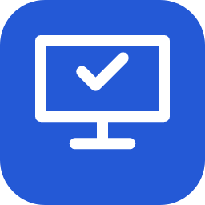
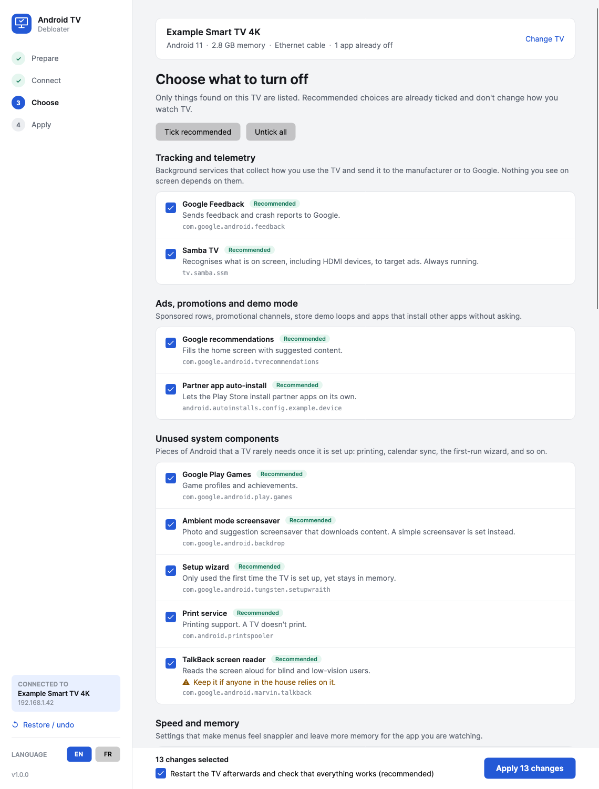
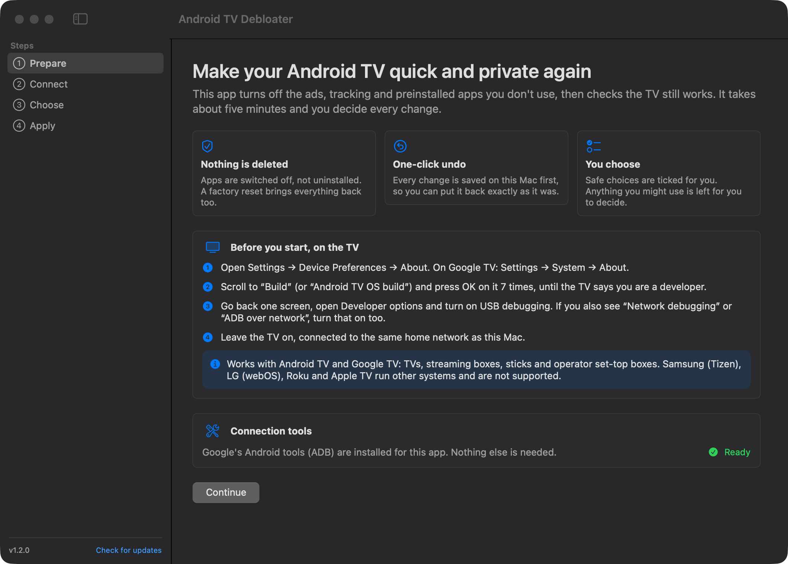
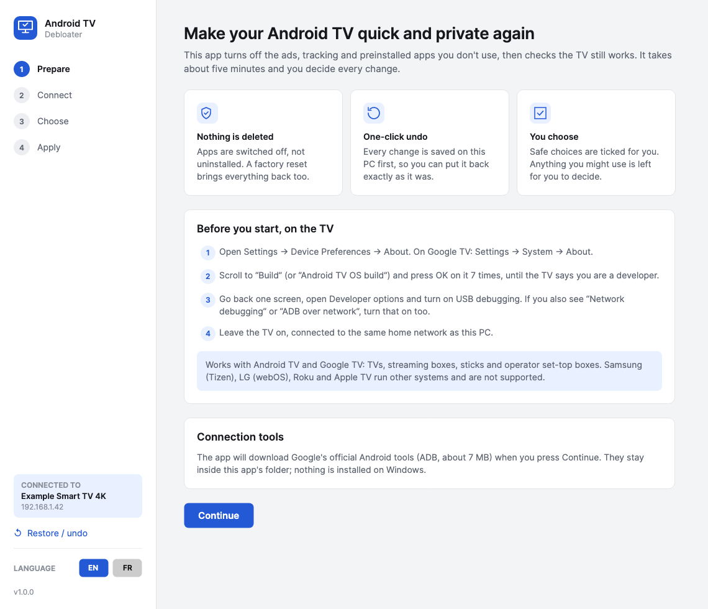
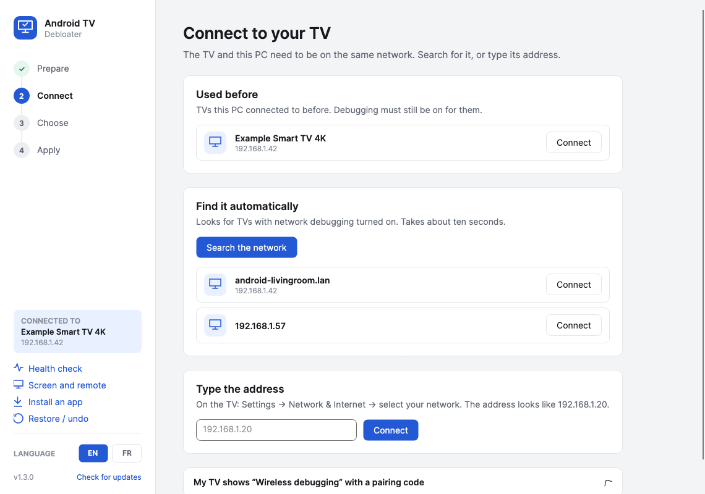
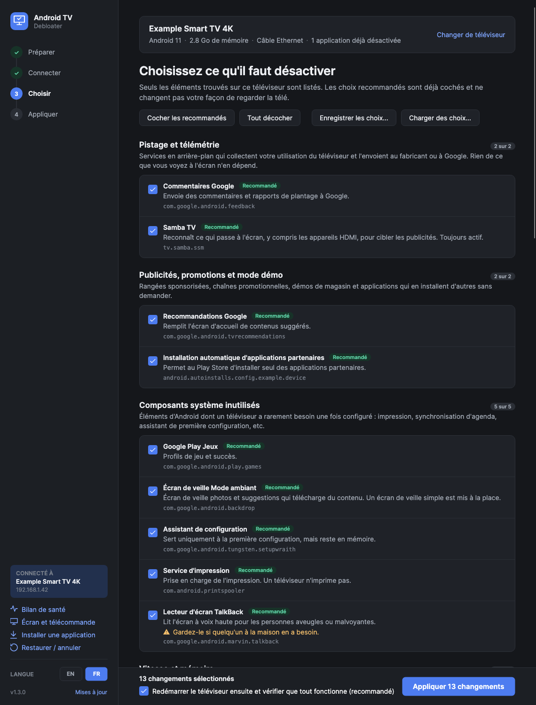
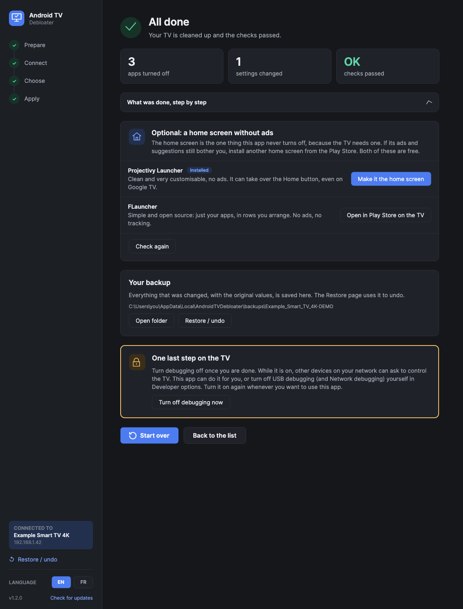
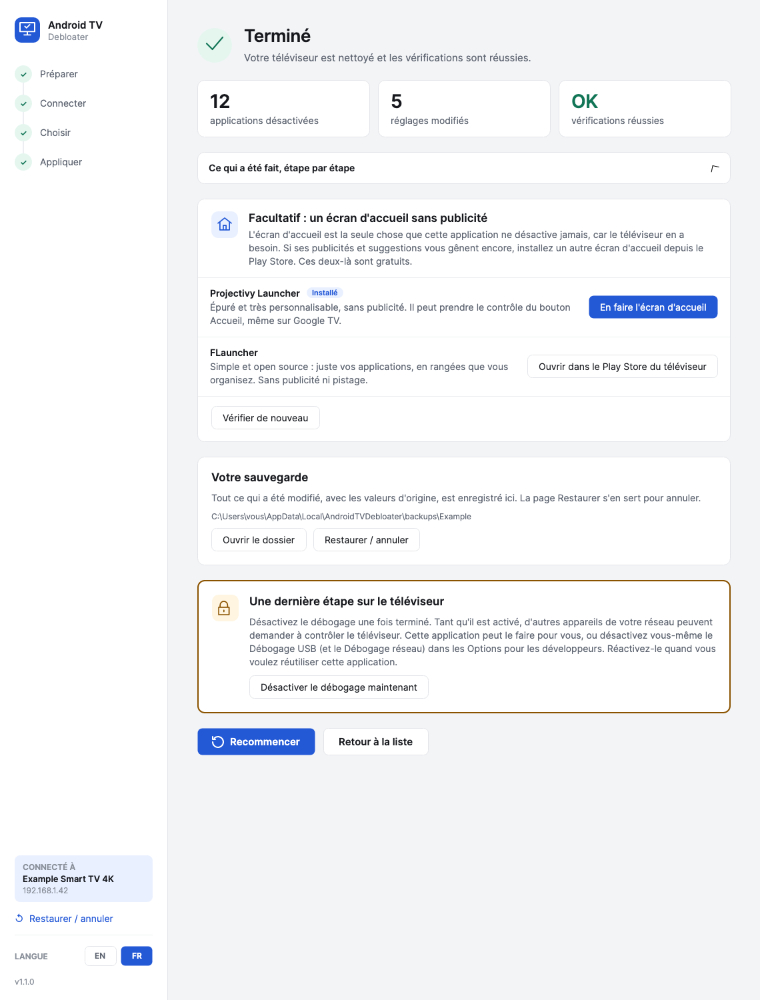
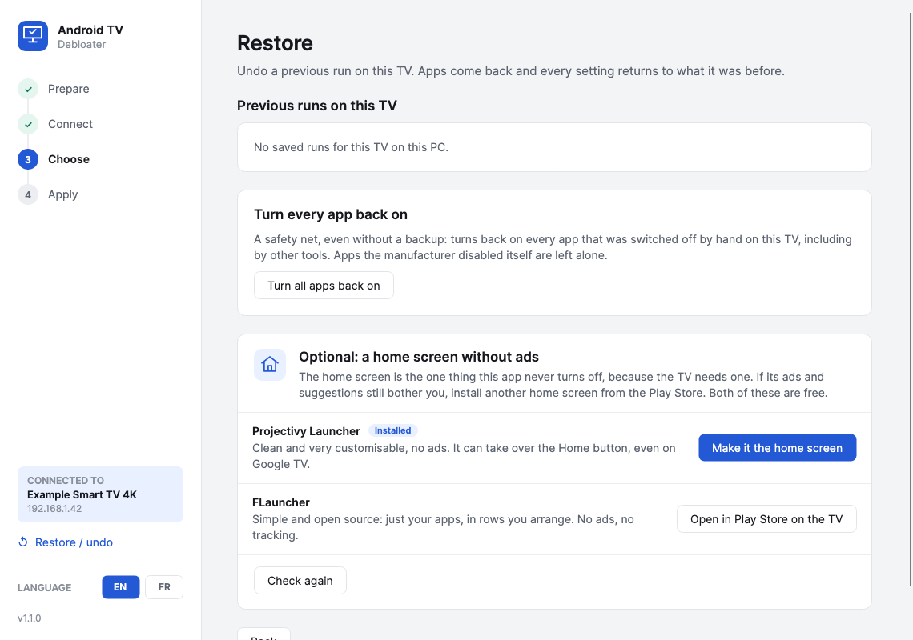

<p align="center"></p>

<h1 align="center">Android TV Debloater</h1>

<p align="center">
  Turn off the ads, tracking and preinstalled apps on any Android TV or Google TV, from Windows, macOS or Linux.<br>
  One window, plain-language choices, a one-click undo.
</p>

<p align="center"><a href="README.fr.md">Version française</a></p>



## What it does

- **Finds your TV on the network** and connects over Wi-Fi or Ethernet. No cable, no root.
- **Lists only what is on your TV**, grouped and explained in plain words: tracking, ads and demo
  mode, unused system parts, Google features, preinstalled apps, plus speed and privacy settings.
- **Ticks the safe choices for you.** Anything you might use (voice search, casting, streaming
  apps) is left unticked, with a warning that says what stops working.
- **Backs up first, then applies, restarts the TV and checks it**: home screen, internet and name
  lookups. If the ad-blocking DNS breaks lookups, it is undone on the spot.
- **Undo any run exactly** from the Restore page, or turn every app back on in one click.
- **Suggests a home screen without ads** (Projectivy Launcher, FLauncher): opens it in the Play Store
  on the TV, makes it the home screen once installed, and can put the original one back.
- **Turns debugging off for you** at the end, then **Start over** to clean the next TV. TVs you
  used before are listed on the Connect page.
- **Same choices on the next TV**: the last run's choices are offered on the next TV, and choices
  can be saved to a file and loaded on another computer (Windows and Mac read the same file).
- **Frees up storage** by clearing app caches, and shows how much was freed.
- **The list of apps updates itself**: new entries in [`shared/catalog.json`](shared/catalog.json)
  reach every copy of the app without a new release.
- **Help improve the list**: preinstalled apps the list doesn't know yet can be suggested on GitHub
  in one click (only the TV model and app names; you see everything before posting).
- **Updates itself**: when a new version is out, it shows what's new and installs it in a few
  seconds (the download is checked against the SHA-256 GitHub publishes). Can be turned off.
- **English and French**, switchable at any time. Light and dark themes follow Windows.

Nothing is uninstalled. Apps are disabled with Android's own `pm disable-user`, and a factory reset
brings everything back as well.

## Download and run

Get the file for your computer from the [latest release](../../releases/latest). There is nothing
else to install: the first time, the app downloads Google's official ADB tools (about 7 MB from
`dl.google.com`) into its own folder. Then follow the four steps on screen.

| | File | First launch |
|---|---|---|
| **Windows** 10/11 | `AndroidTVDebloater.exe` | SmartScreen may warn about an unknown publisher (the app isn't code-signed): **More info → Run anyway**. |
| **macOS** 14+ | `AndroidTVDebloater-mac.zip` | A native Mac app (SwiftUI), for Apple silicon and Intel, signed and notarized by Apple. Unzip, move it to Applications and open it. Allow it to find devices on the local network when asked. Updates arrive through Sparkle. |
| **Linux** x64 | `AndroidTVDebloater-x86_64.AppImage` | Runs on most distributions (Ubuntu 22.04 and newer, Fedora, Debian, Mint…). Make it executable (`chmod +x`, or Properties → Allow executing) and open it. It updates itself; AppImage managers such as Gear Lever can update it too. A plain `AndroidTVDebloater-linux-x64` program is also attached. |



### On the TV, before you start

1. **Settings → Device Preferences → About** (Google TV: **Settings → System → About**).
2. Press OK on **Build** (or **Android TV OS build**) 7 times, until it says you are a developer.
3. Back one screen: **Developer options → USB debugging** on. If there is a **Network debugging**
   or **ADB over network** switch, turn it on too.
4. When the app connects, accept **Allow USB debugging?** on the TV and tick *Always allow*.

Newer Google TV devices that only offer **Wireless debugging** with a pairing code are supported
from the Connect page.

When you are done, turn USB debugging off again. The last screen has a button that does it.

## Screens

| | |
|---|---|
|  |  |
|  |  |
|  |  |

## Supported devices

Anything running **Android TV** or **Google TV**: TVs (Sony, TCL, Xiaomi, Philips, Hisense…),
streaming boxes and sticks (Chromecast with Google TV, NVIDIA Shield, Mi Box…) and the Android TV
set-top boxes that many TV operators rent out. Fire TV works for the app list.

**Not supported:** Samsung (Tizen), LG (webOS), Roku and Apple TV run other systems.

## How it stays safe

- Only apps in a reviewed catalog ([`catalog.json`](shared/catalog.json)) are
  offered, plus apps installed on top of the system (always unticked).
- Never offered, whatever the catalog says: any app that can act as the home screen, the keyboard,
  Settings, the Play Store, Google Play Services, WebView, Bluetooth and the core of Android.
- Every change is written to a backup file with its original value *before* it is made, and the
  file is saved after each step, so even an interrupted run can be undone.
- "Turn Wi-Fi off" is only offered when the TV is on an Ethernet cable.
- Backups live in `%LOCALAPPDATA%\AndroidTVDebloater\backups\<TV>` (Mac:
  `~/Library/Application Support/AndroidTVDebloater/backups`), with a raw snapshot of all packages
  and settings next to them. The format is the same on every system.

## Build from source

Windows and Linux app: requires the [.NET 10 SDK](https://dotnet.microsoft.com/download).
`linux/build-appimage.sh` builds the AppImage on Linux.

```sh
# Run it (on macOS/Linux it runs too, handy for development)
dotnet run --project src/AndroidTVDebloater

# Single self-contained Windows exe in ./publish
dotnet publish src/AndroidTVDebloater -c Release -r win-x64 -o publish
```

`tools/Screenshots` renders every page off-screen to PNG (light/dark, EN/FR) with a simulated TV:
`dotnet run --project tools/Screenshots -- docs`.

Mac app (`mac/`, Swift and SwiftUI, updates with [Sparkle](https://sparkle-project.org)): requires
Xcode. `mac/build-app.sh` builds `mac/build/Android TV Debloater.app` (ad-hoc signed for local use;
release builds are signed with a Developer ID, notarized and get a Sparkle appcast, see the script). Its text comes from the Windows app's `Strings.cs`: after
changing it, run `python3 tools/gen-mac-strings.py`.

Pushing a tag like `v1.2.0` builds all three on GitHub Actions and publishes a release; the tag
message becomes the release notes shown in the apps' update window.

## Adding apps to the catalog

Edit [`shared/catalog.json`](shared/catalog.json), used by both apps. Each app entry has a
package `id` (or a `prefix`), a `group`, `recommended`, and `name` / `description` (plus an
optional `warning`) in English and French. Settings live in the same file. Only mark something
`recommended` if disabling it changes nothing a viewer would notice, and test it on a real device.
**Increase `version`** in the file: the apps download it from `main` and use it when it is newer
than their own copy.

## Credits

Several catalog entries come from the device lists contributed to
[cleanyourtv](https://github.com/Gathin23/cleanyourtv) (MIT). See [NOTICE](NOTICE).

## Licence

MIT. Use at your own risk: the app only disables and restores, but you are changing your own device.
